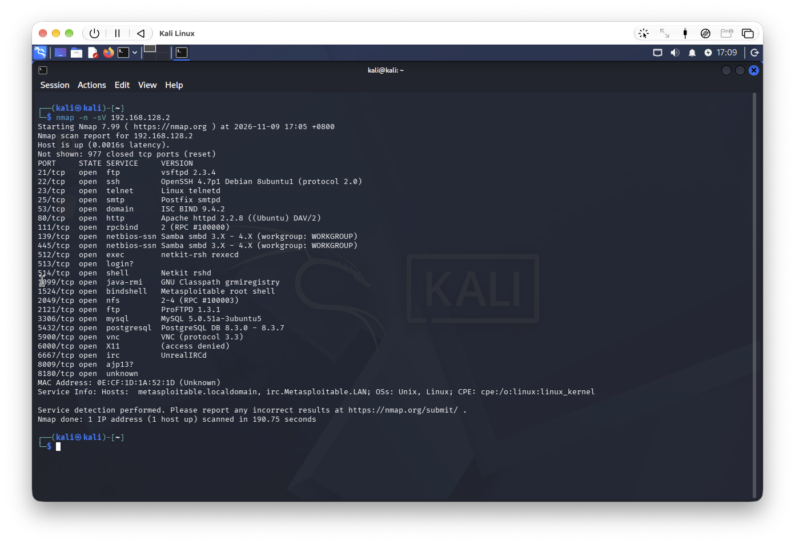

# Cybersecurity Virtual Lab Setup

## 1. Project Overview

This project involved setting up an isolated virtual laboratory to practise cybersecurity techniques in a controlled environment.

The laboratory provides a platform for learning network reconnaissance, service enumeration, and basic security testing without affecting production systems or external networks.

## 2. Objectives

- Set up a virtual cybersecurity laboratory using UTM.
- Configure Kali Linux as the security testing machine.
- Deploy Metasploitable 2 as a deliberately vulnerable target.
- Establish network connectivity between the virtual machines.
- Perform network reconnaissance using Nmap.

## 3. Tools and Environment

| Component | Description |
|---|---|
| Virtualisation | UTM |
| Security Testing Machine | Kali Linux |
| Target Machine | Metasploitable 2 |
| Network | Isolated host-only network |
| Security Tool | Nmap |

## 4. Lab Network Configuration

Both virtual machines were connected through an isolated host-only network, allowing them to communicate without exposing the vulnerable target to external networks.

The laboratory consisted of two machines:

- **Kali Linux:** Used for network reconnaissance and security testing.
- **Metasploitable 2:** Used as a deliberately vulnerable target for security exercises.

## 5. Methodology

### Step 1 — Virtual Machine Setup

Configured Kali Linux and Metasploitable 2 as separate virtual machines using UTM.

### Step 2 — Network Configuration

Connected both machines to the host-only network and verified their network configurations.

### Step 3 — Connectivity Testing

Used `ping` to verify network communication between Kali Linux and Metasploitable 2.

### Step 4 — Network Reconnaissance

Performed an Nmap service detection scan:

```bash
nmap -n -sV <target-ip>
```

The `-n` option disables DNS resolution, while `-sV` attempts to identify running services and their versions.

## 6. Results

Nmap identified **23 open TCP ports** on the Metasploitable 2 target, including:

| Port | Service | Detected Software |
|---|---|---|
| 21 | FTP | vsftpd 2.3.4 |
| 22 | SSH | OpenSSH 4.7p1 |
| 23 | Telnet | Linux telnetd |
| 80 | HTTP | Apache httpd 2.2.8 |
| 139, 445 | SMB | Samba smbd 3.X–4.X |
| 3306 | MySQL | MySQL 5.0.51a |

These findings demonstrated how network reconnaissance can reveal exposed services that may require further security investigation.

### Scan Evidence

The following screenshot shows the Nmap service detection results from the isolated laboratory.



The scan identified 23 open TCP ports and several running services on the Metasploitable 2 target.

## 7. Challenges and Troubleshooting

During the initial service detection scan, Nmap took longer than expected to complete.

I investigated the issue and repeated the scan with the `-n` option to disable DNS resolution. This allowed the scan to complete more efficiently.

## 8. Lessons Learned

This project strengthened my understanding of virtualisation, network isolation, IP addressing, connectivity testing, and service enumeration.

It also provided practical experience in troubleshooting network scanning commands and interpreting basic reconnaissance results.

## 9. Future Improvements

- Explore additional Nmap scanning techniques.
- Investigate the security implications of identified services.
- Practise vulnerability assessment within the isolated laboratory.
- Improve documentation of scanning results and security findings.